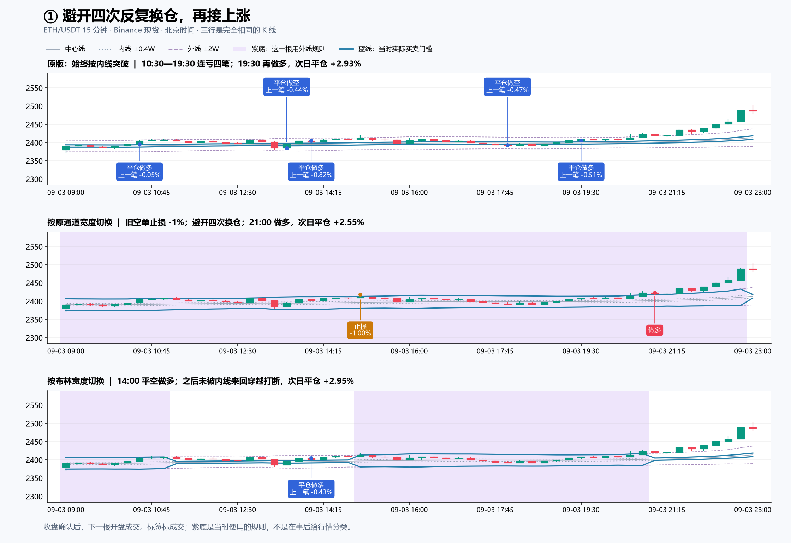
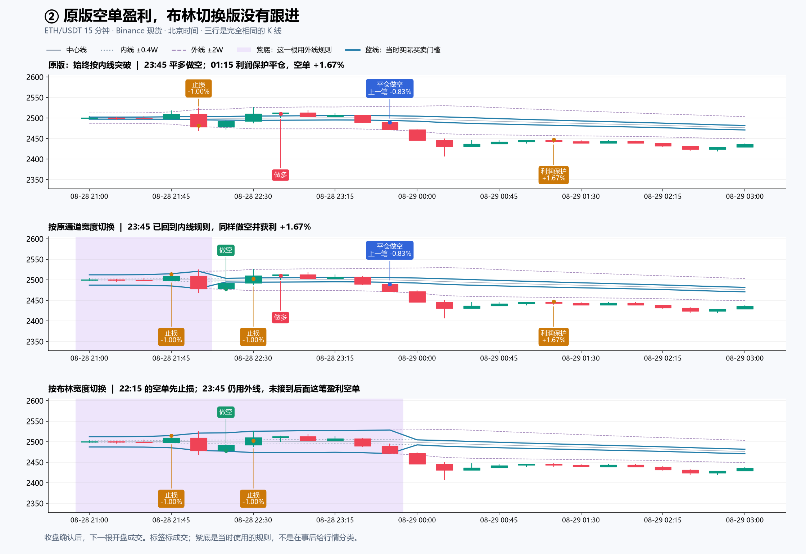
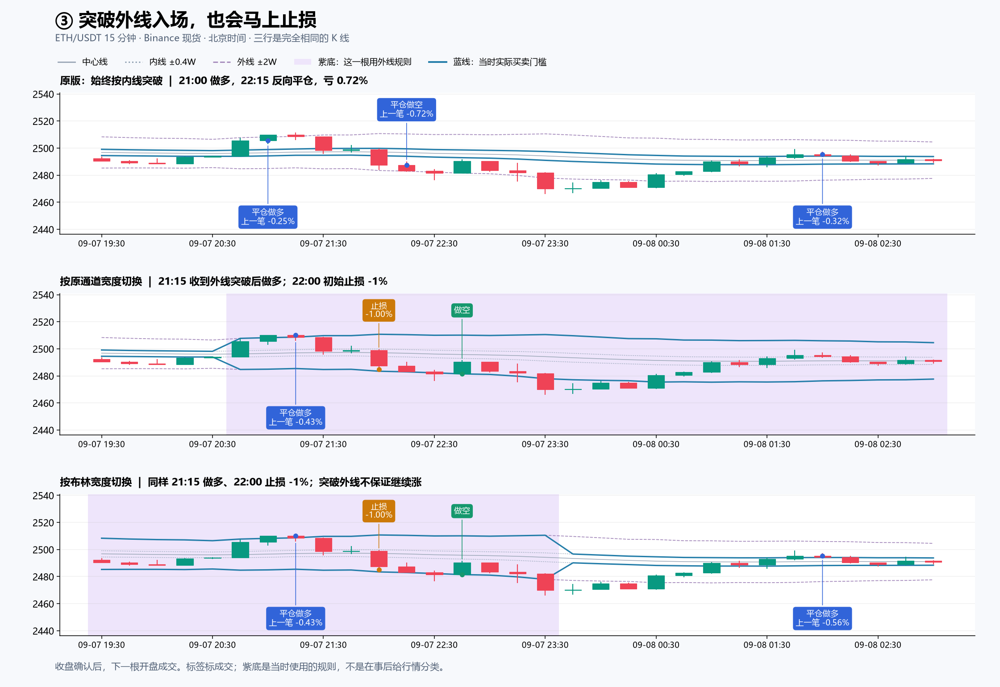

# 宽窄切换是怎样交易的：三段真实 K 线

2026 年，Binance 现货 ETH/USDT、15 分钟、北京时间。三行分别是原版、按原通道宽度切换、按布林宽度切换。紫色背景表示当根采用外线门槛；白色采用内线门槛。蓝线是实际门槛。布林版只用布林带判断宽窄，实际买卖线仍来自 EMA55 通道。

买卖标签放在实际成交 K 线上。收盘形成信号，下一根开盘成交。反手合并为一个“平仓做多／平仓做空”标签，“上一笔”收益属于刚刚平掉的仓位。橙色标签区分止损与利润保护。未画持续止损线。图是历史记录的说明性实例，不是随机抽样，不用于代替六年统计。

## 1. 9 月 3 日：避开反复换仓，再抓上涨

原版 10:30、13:30、14:00、18:00 开出的四笔分别亏约 0.44%、0.82%、0.47%、0.51%；19:30 再做多。

原通道切换版一直采用更远的外线门槛，没有这四笔来回换仓。20:45 那根收盘 2423.27，高于外线 2417.30，于 21:00 做多，9 月 4 日 20:30 利润保护退出，盈利约 2.55%。它也有代价：之前持有的空单拖到了 1% 止损，并非整段没有亏损。

布林切换版在 14:00 使用内线规则平空做多；随后转入外线模式，没有因 18:00 跌破内线就平多，持有至次日 20:30，盈利约 2.95%。原版最后那笔多单盈利约 2.93%。图只显示 9 月 3 日，次日退出数值来自已保存的完整交易。

## 2. 8 月 28 日晚：切换规则的衔接会漏掉机会

原版和原通道切换版都在 23:45 平多做空，次日 01:15 利润保护退出，这笔空单赚约 1.67%。布林版此前 22:15 做空、22:30 止损，之后没有跟上这次下跌。

原因可以具体定位：23:30 那根收盘为 2489.14，低于内线 2494.81，但还没有跌破布林版当时采用的外线 2473.05，所以布林版不做空。23:45 那根收盘 2471.89，仍略高于其外线 2470.95。

00:00 那根切回内线规则；为了避免切换门槛本身制造假穿越，代码要求前后两根都按内线判断。但上一根价格已经在内线下面，因此没有“从上往下新穿越”，仍不做空，后面的下跌就漏掉了。

这是一个可核查的规则衔接问题。它说明损失可能来自切换后的入场资格，而不只是通道宽度判断；没有据此推断六年收益差全由这一机制造成，也没有在本次展示中修改规则。

## 3. 9 月 7 日：外线突破后仍会反向

两种切换版都在 21:00 那根收盘看到 2510.04 高于外线 2508.25，于 21:15 平空做多。之后价格转跌，在 22:00 所属 K 线内触发 1% 初始止损。随后又在 22:45 收到另一侧外线突破而做空。

原版更早在 21:00 做多，并在 22:15 反向信号平仓，亏约 0.72%。提高突破门槛让本次入场晚了一根，却没有过滤掉失败交易。

## 本地证据

[原始窗口、指标、成交与哈希](examples.json)。每个入场都检查了前后两根在同一门槛下的穿越条件、真实下一开盘成交价；图中窗口没有行情缺口。所有数值来自原已完成回测，本次没有新回测、下载新行情或改 Pine。

对应运行：原版 `4e65bfb4229646299932d76515ec0ac0`；原通道切换 `f61211db66385697e90d92041a56d183`；布林切换 `0feca3b83805ac91d65b80ed1b5e91d4`。图初版与调整标签位置后的 v2 均保留。
